<div align="center">



<br />

[](https://nodejs.org/)
[](https://koajs.com/)
[](https://www.postgresql.org/)
[](https://redis.io/)
[](https://socket.io/)
[](https://www.docker.com/)
[](https://prometheus.io/)

<br />

**[English (EN-US)](#-english-en-us--kanghoo-mobility--telemetry-platform)** · **[Português (PT-BR)](#-português-pt-br--kanghoo-plataforma-de-transporte-escolar-e-excursões)**

</div>

---

# 🇺🇸 English (EN-US) | Kanghoo Mobility & Telemetry Platform

**Kanghoo** is a full-stack logistics and mobility platform designed for school transit and charter excursions. It provides real-time vehicle GPS telemetry, passenger boarding/alighting check-ins, automated guardian notifications, subscription/payment workflows, and multi-role access control (Guardians, Drivers, Monitors, and Administrators).

---

### 🏗️ Architectural Highlights

- **Clean Architecture & Dependency Injection:** Strict separation across `domain`, `application`, `infrastructure`, and `interface` layers inside `server/src/`, wired with **Awilix** dependency injection containers.
- **Real-Time GPS Telemetry Engine:** Low-latency bidirectional communication via **Socket.IO / WebSockets** backed by **Redis 7+** for live vehicle tracking, speed monitoring, and route geofencing.
- **23+ RESTful API Routes:** Comprehensive HTTP layer covering authentication (`JWT` + `Bcrypt`), role-based access control (`RBAC`), passenger check-ins, route scheduling, excursion packages, notifications, and analytics.
- **Production-Grade Security & Observability:** Rate limiting, request schema validation (`Joi`), structured logging (`Winston`), reverse proxy hardening (`Nginx`), and real-time metrics collection via **Prometheus** and **Grafana** dashboards.
- **Multi-Container Orchestration:** Fully containerized development (`docker-compose.yml`) and production (`docker-compose.prod.yml`) environments.

---

### 🛠️ Technology Stack

| Layer | Technology |
| :--- | :--- |
| **Runtime** | Node.js v20+ (ES Modules) |
| **HTTP Frameworks** | Koa.js & Express.js |
| **Relational Database** | PostgreSQL 14+ (Normalized schema + SQL migrations) |
| **In-Memory Cache & Pub/Sub** | Redis 7+ |
| **Real-Time Telemetry** | Socket.IO / WebSockets |
| **Dependency Injection** | Awilix |
| **Security & Validation** | JWT, Bcrypt, Helmet, Rate Limiting, Joi |
| **Reverse Proxy** | Nginx |
| **Containerization** | Docker & Docker Compose |
| **Observability** | Prometheus, Grafana & Winston Structured Logging |
| **Testing & Quality** | Jest, Supertest & ESLint |

---

### 📂 Repository Structure

```text
├── server/                  # Backend application (Node.js + Koa.js)
│   └── src/
│       ├── application/     # Application use cases & orchestration
│       ├── config/          # Environment, database & service configuration
│       ├── controllers/     # HTTP request handlers
│       ├── domain/          # Core domain entities & repository contracts
│       ├── infrastructure/  # PostgreSQL repositories & external adapters
│       ├── interface/       # Delivery layer (HTTP & WebSocket gateways)
│       ├── middlewares/     # Authentication, RBAC, rate-limiting & validation
│       ├── routes/          # 23+ modular REST API routes
│       ├── services/        # Business services (GPS, alerts, billing)
│       └── utils/           # Shared utilities (logger, geospatial math, cache)
├── frontend/                # Web client interface
│   └── public/              # Role-specific portals, interactive maps & assets
├── database/                # PostgreSQL initialization & migration scripts
├── nginx/                   # Reverse proxy & TLS configuration
├── monitoring/              # Prometheus targets & Grafana dashboards
├── docker-compose.yml       # Local development orchestration
└── docker-compose.prod.yml  # Production deployment orchestration
```

---

### 🚀 Quick Start

```bash
# 1. Install backend dependencies
cd server && npm install

# 2. Configure environment variables
cp .env.example .env

# 3. Start the development server with hot-reload
npm run dev
```

The API and web server will be available at `http://localhost:3000`.

#### Useful Commands

```bash
npm run dev          # Start development server with hot-reload (nodemon)
npm test             # Run automated test suites (Jest)
npm run lint         # Run static code analysis (ESLint)
npm run format       # Format source files (Prettier)
```

---

### 📚 Technical Documentation Index

| Document | Description |
| :--- | :--- |
| [Architecture (`docs/ARQUITETURA.md`)](docs/ARQUITETURA.md) | Clean Architecture layers, design patterns, and module boundaries |
| [API Reference (`docs/API.md`)](docs/API.md) | REST endpoints, request/response payloads, and WebSocket events |
| [Configuration (`docs/guias/CONFIGURACAO.md`)](docs/guias/CONFIGURACAO.md) | Environment variables, PostgreSQL, and Redis setup |
| [Development Guide (`docs/guias/DESENVOLVIMENTO.md`)](docs/guias/DESENVOLVIMENTO.md) | Engineering workflow, coding standards, and testing conventions |
| [Test Accounts (`docs/guias/USUARIOS_TESTE.md`)](docs/guias/USUARIOS_TESTE.md) | Seeded credentials for local development and QA validation |
| [Deployment (`docs/producao/DEPLOY.md`)](docs/producao/DEPLOY.md) | Production deployment guide using Docker Compose and Nginx |
| [Security (`docs/producao/SEGURANCA.md`)](docs/producao/SEGURANCA.md) | Security hardening, JWT policies, and firewall configuration |
| [Monitoring (`docs/producao/MONITORAMENTO.md`)](docs/producao/MONITORAMENTO.md) | Prometheus metrics, Grafana dashboards, and backup routines |

---
---

# 🇧🇷 Português (PT-BR) | Kanghoo: Plataforma de Transporte Escolar e Excursões

**Kanghoo** é uma plataforma completa para gestão de transporte escolar e excursões com rastreamento GPS veicular em tempo real, conferência de embarque e desembarque, notificações automáticas para responsáveis, gestão financeira e controle de acesso por múltiplos perfis (Responsáveis, Motoristas, Monitores e Administradores).

---

### 🏗️ Destaques de Arquitetura

- **Clean Architecture e Injeção de Dependência:** Separação rigorosa de responsabilidades entre as camadas `domain`, `application`, `infrastructure` e `interface` em `server/src/`, orquestradas com **Awilix**.
- **Motor de Telemetria GPS em Tempo Real:** Comunicação bidirecional de baixa latência via **Socket.IO / WebSocket** integrada ao **Redis 7+** para rastreamento ao vivo de rotas, velocidade e cercas eletrônicas (geofencing).
- **Mais de 23 Rotas RESTful:** Camada HTTP completa cobrindo autenticação (`JWT` + `Bcrypt`), controle de acesso baseado em papéis (`RBAC`), check-in de passageiros, agendamento de rotas, pacotes de excursão e relatórios.
- **Segurança e Observabilidade de Produção:** Rate limiting, validação de esquemas (`Joi`), logs estruturados (`Winston`), proxy reverso (`Nginx`) e coleta de métricas em tempo real com **Prometheus** e **Grafana**.
- **Orquestração Multi-Container:** Ambientes de desenvolvimento (`docker-compose.yml`) e produção (`docker-compose.prod.yml`) totalmente containerizados.

---

### 🛠️ Stack Tecnológica

| Camada | Tecnologia |
| :--- | :--- |
| **Runtime** | Node.js v20+ (ES Modules) |
| **Framework HTTP** | Koa.js & Express.js |
| **Banco de Dados** | PostgreSQL 14+ (Modelagem relacional e migrações SQL) |
| **Cache e Pub/Sub** | Redis 7+ |
| **Tempo Real** | Socket.IO / WebSocket |
| **Injeção de Dependência** | Awilix |
| **Segurança e Validação** | JWT, Bcrypt, Helmet, Rate Limiting, Joi |
| **Proxy Reverso** | Nginx |
| **Containerização** | Docker / Docker Compose |
| **Monitoramento** | Prometheus, Grafana e Logs Estruturados (Winston) |
| **Testes e Qualidade** | Jest, Supertest e ESLint |

---

### 🚀 Início Rápido

```bash
# 1. Instalar dependências do servidor
cd server && npm install

# 2. Configurar variáveis de ambiente
cp .env.example .env

# 3. Iniciar em modo de desenvolvimento
npm run dev
```

O servidor estará disponível em `http://localhost:3000`.

#### Comandos Úteis

```bash
npm run dev          # Servidor com hot-reload (nodemon)
npm test             # Executar suíte de testes automatizados
npm run lint         # Análise estática de código
npm run format       # Formatação automática de código
```

---

### 📚 Documentação Técnica

| Documento | Descrição |
| :--- | :--- |
| [Arquitetura (`docs/ARQUITETURA.md`)](docs/ARQUITETURA.md) | Camadas do sistema e padrões de projeto |
| [Referência de APIs (`docs/API.md`)](docs/API.md) | Endpoints, payloads e exemplos |
| [Configuração (`docs/guias/CONFIGURACAO.md`)](docs/guias/CONFIGURACAO.md) | Variáveis de ambiente e banco de dados |
| [Desenvolvimento (`docs/guias/DESENVOLVIMENTO.md`)](docs/guias/DESENVOLVIMENTO.md) | Fluxo de trabalho e padrões de código |
| [Usuários de Teste (`docs/guias/USUARIOS_TESTE.md`)](docs/guias/USUARIOS_TESTE.md) | Credenciais para ambiente de desenvolvimento |
| [Deploy (`docs/producao/DEPLOY.md`)](docs/producao/DEPLOY.md) | Deploy com Docker e Nginx |
| [Segurança (`docs/producao/SEGURANCA.md`)](docs/producao/SEGURANCA.md) | Hardening e configurações de firewall |
| [Monitoramento (`docs/producao/MONITORAMENTO.md`)](docs/producao/MONITORAMENTO.md) | Métricas, logs e backup |

---

### 👤 Autor / Author

**Rodrigo Souza Feliciano** · Full Stack Software Developer
- **Portfolio:** [portfolio-rodrigo-pink.vercel.app](https://portfolio-rodrigo-pink.vercel.app)
- **LinkedIn:** [linkedin.com/in/rodrigosouzafeliciano](https://www.linkedin.com/in/rodrigosouzafeliciano/)
- **Online Resume:** [github.com/rodrigosouzafeliciano/curriculo-online](https://github.com/rodrigosouzafeliciano/curriculo-online)
